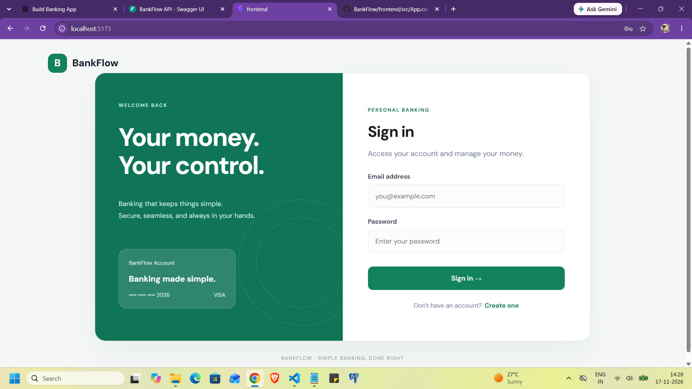
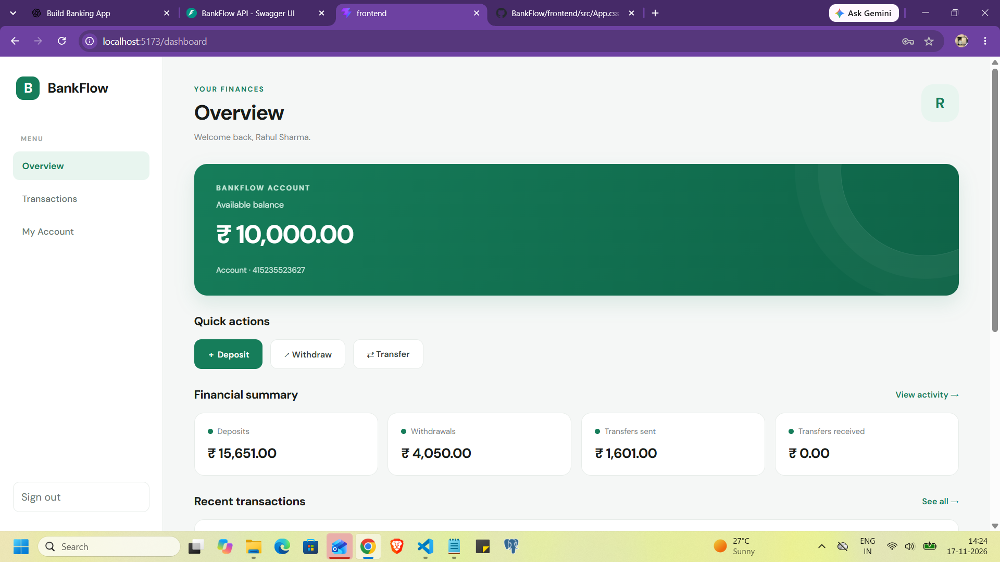
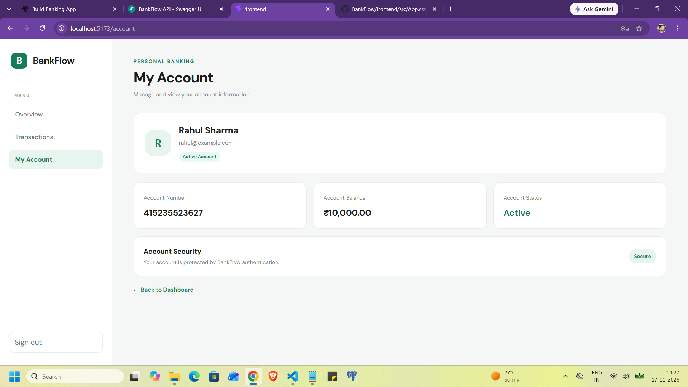

# BankFlow – Full-Stack Banking Application

BankFlow is a full-stack banking application built using **FastAPI, PostgreSQL, SQLAlchemy, and React**. It provides secure user authentication, account management, financial transactions, transaction history, password recovery, and PDF bank statement generation.

The project demonstrates REST API development, database management, authentication, frontend integration, and transaction handling.

## Features

### Authentication & Security
- User registration and login.
- JWT-based authentication.
- Secure password hashing.
- Change password functionality.
- Forgot password and reset password functionality.
- Reset tokens with expiry and single-use validation.

### Account Management
- Automatic savings account creation during registration.
- Unique account number generation.
- Account balance and account details.
- Minimum balance protection.

### Banking Transactions
- Deposit money.
- Withdraw money with minimum balance validation.
- Transfer funds between accounts.
- Transactional integrity during transfers.
- Transaction history with pagination and filtering.
- Transaction summary.
- Transaction lookup using transaction reference.

### Additional Features
- PDF bank statement generation.
- Interactive API documentation using Swagger UI.
- Responsive React frontend.
- Dashboard with account balance and financial summary.
- Recent transaction display.
- Automated testing using Pytest.

## Tech Stack

| Technology | Purpose |
|---|---|
| Python | Backend programming |
| FastAPI | REST API development |
| PostgreSQL | Relational database |
| SQLAlchemy | ORM and database operations |
| Pydantic | Request validation |
| JWT | Authentication |
| React | Frontend development |
| JavaScript | Frontend logic |
| HTML & CSS | User interface and styling |
| Pytest | Automated testing |
| ReportLab | PDF statement generation |
| Vite | Frontend development server |

## Application Screenshots

### Login Page


### Dashboard


### Transactions


### My Account


## API Endpoints

### Authentication

| Method | Endpoint | Description |
|---|---|---|
| POST | `/auth/register` | Register a new user |
| POST | `/auth/login` | Login and receive JWT |
| GET | `/auth/me` | Get authenticated user |
| POST | `/auth/change-password` | Change password |
| POST | `/auth/forgot-password` | Generate password reset token |
| POST | `/auth/reset-password` | Reset password using token |

### Accounts

| Method | Endpoint | Description |
|---|---|---|
| GET | `/accounts/me` | Get authenticated user's account |

### Transactions

| Method | Endpoint | Description |
|---|---|---|
| POST | `/transactions/deposit` | Deposit money |
| POST | `/transactions/withdraw` | Withdraw money |
| POST | `/transactions/transfer` | Transfer money |
| GET | `/transactions/history` | View transaction history |
| GET | `/transactions/summary` | Get transaction summary |
| GET | `/transactions/statement` | Download PDF bank statement |
| GET | `/transactions/{transaction_reference}` | Retrieve transaction details |

## Installation & Setup

### 1. Clone the repository

```bash
git clone https://github.com/Aayushxdd09/BankFlow.git
cd BankFlow
```

### 2. Backend Setup

Navigate to the backend directory:

```bash
cd backend
```

Create a virtual environment:

```bash
python -m venv venv
```

Activate it on Windows:

```powershell
.\venv\Scripts\Activate.ps1
```

Install dependencies:

```bash
pip install -r requirements.txt
```

### 3. Configure Environment Variables

Create a `.env` file inside the `backend` directory:

```env
DB_USER=postgres
DB_PASSWORD=your_password
DB_HOST=localhost
DB_PORT=5433
DB_NAME=bankflow_db
SECRET_KEY=your_secret_key
```

Replace the values with your local PostgreSQL credentials and a secure secret key.

### 4. Run the Backend

From the `backend` directory:

```bash
uvicorn app.main:app --reload
```

The backend will run at:

`http://127.0.0.1:8000`

### 5. Frontend Setup

Open another terminal and navigate to the frontend directory:

```bash
cd frontend
```

Install dependencies:

```bash
npm install
```

Start the frontend development server:

```bash
npm run dev
```

Open the local URL displayed by Vite, usually:

`http://localhost:5173`

## API Documentation

Swagger UI:

`http://127.0.0.1:8000/docs`

ReDoc:

`http://127.0.0.1:8000/redoc`

## Running Tests

Navigate to the backend directory and run:

```bash
python -m pytest -v
```

The backend test suite previously reported **7 passing tests**.

## Project Structure

```text
BankFlow/
│
├── backend/
│   ├── app/
│   │   ├── core/
│   │   ├── models/
│   │   ├── routes/
│   │   ├── schemas/
│   │   ├── services/
│   │   ├── database.py
│   │   ├── main.py
│   │   └── security.py
│   │
│   ├── tests/
│   ├── requirements.txt
│   └── .env.example
│
├── frontend/
│   ├── public/
│   ├── src/
│   │   ├── assets/
│   │   ├── components/
│   │   ├── pages/
│   │   │   ├── Account.jsx
│   │   │   ├── Dashboard.jsx
│   │   │   ├── Login.jsx
│   │   │   ├── Register.jsx
│   │   │   └── Transactions.jsx
│   │   ├── App.css
│   │   ├── App.jsx
│   │   ├── index.css
│   │   └── main.jsx
│   │
│   ├── package.json
│   └── vite.config.js
│
├── screenshots/
│   ├── Dashboard.png
│   ├── Login.png
│   ├── MyAccount.png
│   └── Transactions.png
│
├── .gitignore
└── README.md
```

## Security & Demonstration Notes

- Passwords are stored as secure hashes rather than plain text.
- Protected endpoints require JWT authentication.
- Transaction operations include balance validation and database transaction handling.
- Password recovery currently uses a local demonstration token returned by the API instead of email delivery.
- Reset tokens are currently stored in application memory and are lost when the backend restarts. Persistent token storage and email-based recovery would be needed for production use.

## Disclaimer

BankFlow is an educational portfolio project developed to demonstrate full-stack application development. It is not intended for real banking or production financial transactions.